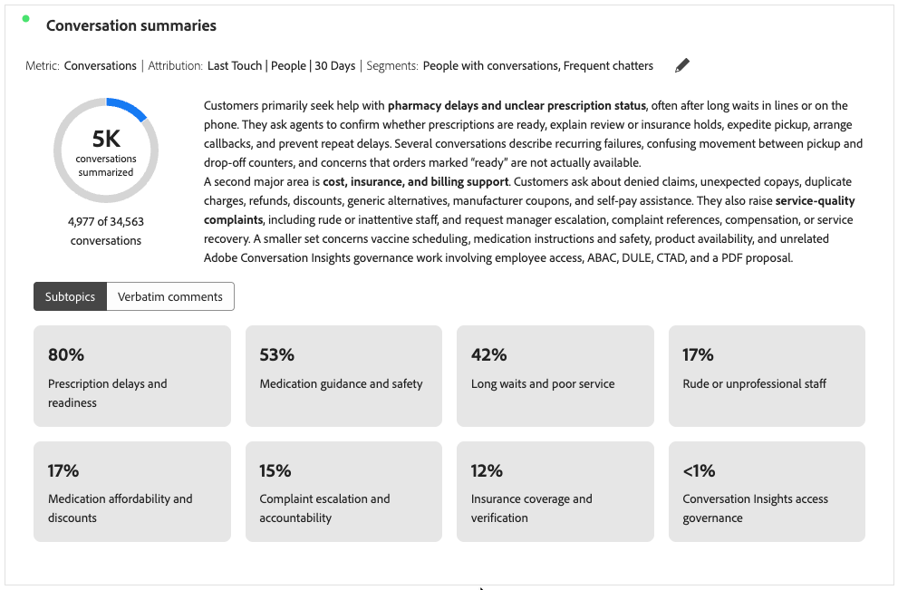
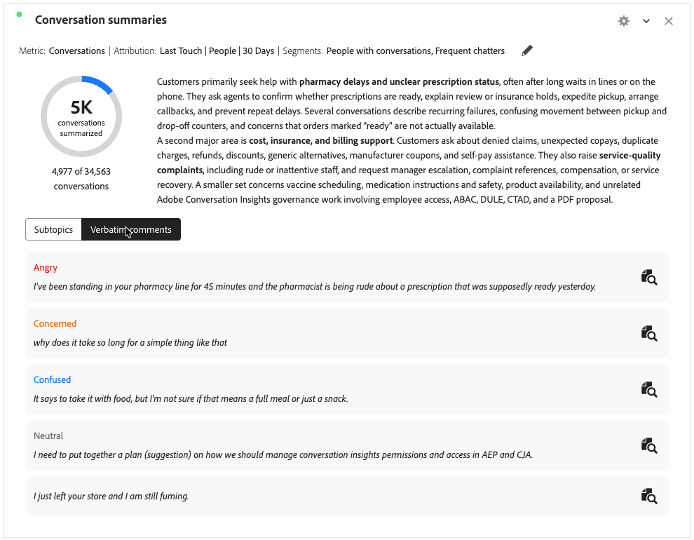

# Récapitulatifs des conversations {#conversation-summaries}

>[!CONTEXTUALHELP]
>id="workspace_conversationsummaries_button"
>title="Récapitulatifs des conversations"
>abstract="Créez une visualisation qui résume un groupe filtré de conversations."

>[!CONTEXTUALHELP]
>id="workspace_conversationsummaries_panel"
>title="Récapitulatifs des conversations"
>abstract="Résumez un groupe filtré de conversations. Contrôlez la longueur du résumé. Consultez les citations représentatives de la clientèle pour valider la précision des signaux extraits. Sélectionnez un devis pour ouvrir la relecture complète de la conversation."

{{release-limited-testing}}

La visualisation  **[!UICONTROL Synthèses des conversations]** vous permet de résumer un groupe filtré de conversations dans le cadre de [Informations sur les conversations](/help/conversation-insights/overview.md).

La visualisation présente un résumé de la mesure sélectionnée (par exemple, Conversations) et affiche des sous-rubriques ou des commentaires textuels lorsque vous avez configuré la visualisation pour inclure des sous-rubriques.

## Création et configuration {#conversation-summaries-create-configure}

>[!CONTEXTUALHELP]
>id="workspace_conversationsummaries_usenondefaultattributionmodel"
>title="Utilisation d’un modèle d’attribution différent du modèle par défaut"
>abstract="Activez un modèle d’attribution autre que celui par défaut pour cette mesure."

>[!CONTEXTUALHELP]
>id="workspace_conversationsummaries_usenondefaultattributionmodel_disabled"
>title="Utilisation d’un modèle d’attribution différent du modèle par défaut"
>abstract="Les modèles d’attribution non par défaut ne sont pas disponibles pour cette mesure."

Pour créer et configurer une visualisation **[!UICONTROL Récapitulatifs des conversations]** :

1. Ajoutez une visualisation  **[!UICONTROL Récapitulatifs des conversations]**. Voir [Ajouter une visualisation à un panneau](/help/analysis-workspace/visualizations/freeform-analysis-visualizations.md#add-visualizations-to-a-panel).

1. Dans la configuration de visualisation **[!UICONTROL Synthèses des conversations]** :

   1. Sélectionnez une **[!UICONTROL mesure]**. Par exemple : **[!UICONTROL Conversations]**.
   1. Si vous souhaitez utiliser un modèle [attribution](/help/analysis-workspace/attribution/models.md) autre que celui par défaut pour la mesure, sélectionnez **[!UICONTROL Utiliser un modèle d’attribution autre que celui par défaut]**, puis sélectionnez **[!UICONTROL Modèle]**, **[!UICONTROL Conteneur]** et **[!UICONTROL Intervalle de recherche en amont]**.
   1. Vous pouvez éventuellement appliquer un segment à la visualisation. Sélectionnez un segment dans le menu déroulant **[!UICONTROL Segments]**.

1. Sélectionnez **[!UICONTROL Créer]** pour créer la visualisation. Sélectionnez **[!UICONTROL Réinitialiser]** pour réinitialiser les valeurs de configuration aux valeurs par défaut. Sélectionnez **[!UICONTROL Annuler]** pour annuler la configuration.

Pour reconfigurer la visualisation **[!UICONTROL Synthèses des conversations]**, sélectionnez  en regard de **[!UICONTROL Mesure : _mesure_]**ou **[!UICONTROL Mesure :_mesure_]** | **[!UICONTROL Segments : _segments_]**.

## Utilisation

Pour utiliser la visualisation :

>[!BEGINTABS]

>[!TAB Sous-rubriques]

>[!TAB Commentaires détaillés]

>[!ENDTABS]

* Si vous avez [inclus des sous-rubriques](#settings), sélectionnez **[!UICONTROL Sous-rubriques]** pour afficher les sous-rubriques ou **[!UICONTROL Commentaires verbatim]** pour afficher les commentaires verbatim.
* Lorsque vous avez sélectionné **[!UICONTROL Commentaires verbatim]**, sélectionnez  pour ouvrir une nouvelle visualisation [**[!UICONTROL Révision de conversation]**](./conversation-review.md) pour la conversation spécifique dont le commentaire textuel fait partie.

Pour parcourir rapidement plusieurs révisions de conversation :

1. Créez un [tableau à structure libre](/help/analysis-workspace/visualizations/freeform-table/freeform-table.md) avec **[!UICONTROL ID de conversation]** et **[!UICONTROL Nom de conversation]** comme dimensions.
1. Sélectionnez le tableau à structure libre comme source de données pour la visualisation **[!UICONTROL Révision des conversations]**.

Sélectionnez une conversation dans le tableau à structure libre pour mettre automatiquement à jour la **[!UICONTROL Révision de conversation]** avec les détails de cette conversation sélectionnée.

## Paramètres

Les [paramètres de visualisation](/help/analysis-workspace/visualizations/freeform-analysis-visualizations.md#settings) spécifiques suivants sont disponibles.

| Paramètre | Description |
|---|---|
| **[!UICONTROL Longueur du résumé]** | Indiquez la longueur du résumé. Vous pouvez choisir entre **[!UICONTROL Court]** ou **[!UICONTROL Long]**. |
| **[!UICONTROL Inclure les sous-rubriques]** | Sélectionnez **[!UICONTROL Inclure les sous-rubriques]** pour afficher les sous-rubriques dans la visualisation. Utilisez **[!UICONTROL Nombre maximal de sous-rubriques]** pour configurer le nombre maximal de sous-rubriques à afficher. |
