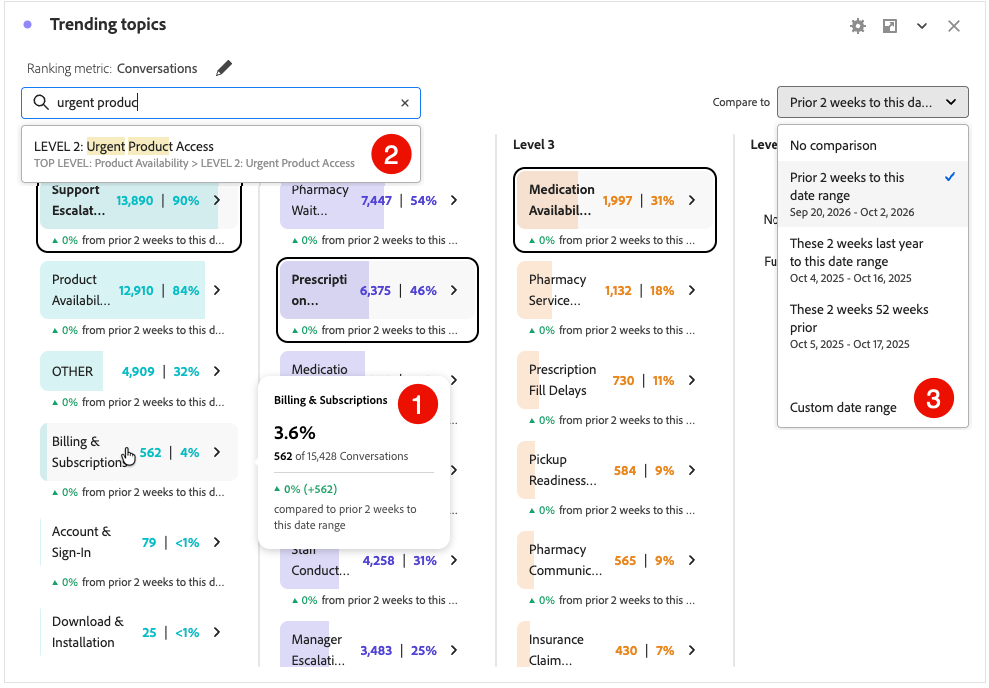
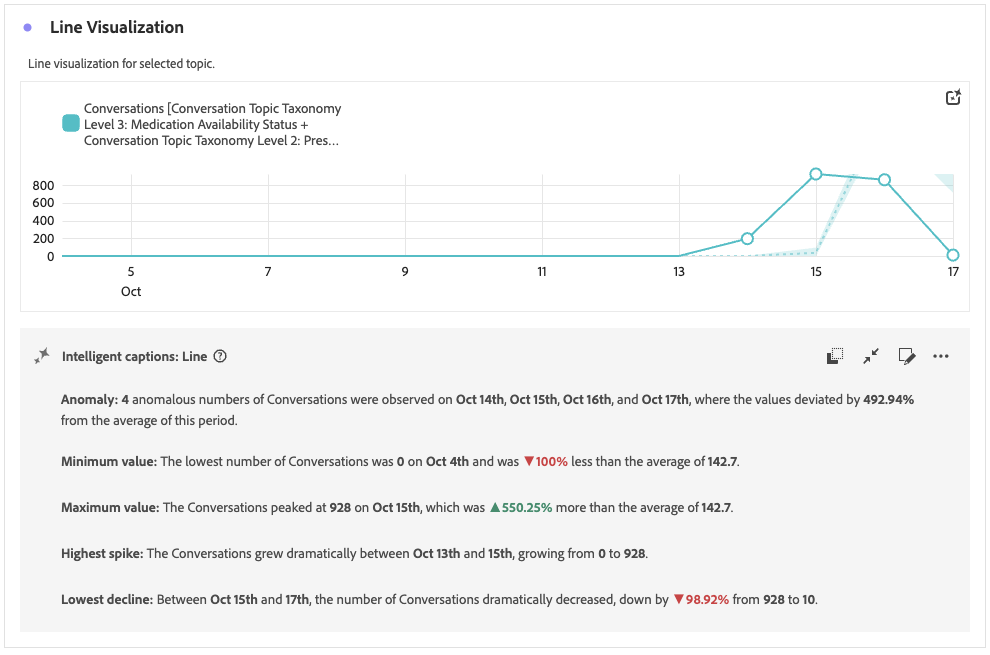

# Sujets de tendance {#trending-topics}

>[!CONTEXTUALHELP]
>id="workspace_trendingtopics_button"
>title="Sujets de tendance"
>abstract="Créez une visualisation qui affiche une répartition hiérarchique des sujets de tendance avec des occurrences et des pourcentages, pour vous aider à identifier les thèmes importants dans les conversations."

>[!CONTEXTUALHELP]
>id="workspace_trendingtopics_panel"
>title="Sujets de tendance"
>abstract="Analysez les sujets de tendance en fonction de la mesure de classement sélectionnée. Sélectionnez des sujets pour effectuer une analyse de jusqu’à cinq niveaux de profondeur. Recherchez des rubriques spécifiques et comparez les rubriques à d’autres périodes."

{{release-limited-testing}}

La visualisation  **[!UICONTROL Sujets de tendance]** vous permet d’explorer et d’analyser les sujets de tendance dans le cadre de [Informations sur les conversations](/help/conversation-insights/overview.md).

Vous pouvez rechercher des rubriques spécifiques et comparer le nombre et le pourcentage de chaque rubrique à chaque niveau avec d’autres plages de données.

## Créer et configurer {#trendimg-topics-create-and-configure}

>[!CONTEXTUALHELP]
>id="workspace_trendingtopics_usenondefaultattributionmodel"
>title="Utiliser un modèle d’attribution différent du modèle par défaut"
>abstract="Activez un modèle d’attribution autre que celui par défaut pour cette mesure."

>[!CONTEXTUALHELP]
>id="workspace_trendingtopics_usenondefaultattributionmodel_disabled"
>title="Utiliser un modèle d’attribution différent du modèle par défaut"
>abstract="Les modèles d’attribution autre que celui par défaut n’est pas disponible pour cette mesure."

Pour créer et configurer une visualisation **[!UICONTROL Tendances]** :

1. Ajoutez une visualisation  **[!UICONTROL Tendance des rubriques]**. Voir [Ajouter une visualisation à un panneau](/help/analysis-workspace/visualizations/freeform-analysis-visualizations.md#add-visualizations-to-a-panel).

1. Dans la configuration de visualisation **[!UICONTROL Tendances des rubriques]** :

   1. Sélectionnez une mesure de **[!UICONTROL classement]**. Par exemple : **[!UICONTROL conversations]**.
   1. Si vous souhaitez utiliser un modèle d’[attribution](/help/analysis-workspace/attribution/models.md) autre que celui par défaut pour la mesure, sélectionnez **[!UICONTROL Utiliser un modèle d’attribution autre que celui par défaut]**, puis **[!UICONTROL Modèle]**, **[!UICONTROL Conteneur]** et **[!UICONTROL Intervalle de recherche en amont]**.
1. Sélectionnez **[!UICONTROL Créer]** pour créer la visualisation. Sélectionnez **[!UICONTROL Réinitialiser]** pour réinitialiser les valeurs de configuration aux valeurs par défaut.

Pour reconfigurer la visualisation des rubriques de tendance, sélectionnez  à côté de **[!UICONTROL Mesure de classement : _mesure de classement_ | Niveaux de sous-rubrique : _x_]**.

## Utilisation

Pour utiliser la visualisation :

* Pointez sur une rubrique pour afficher une fenêtre contextuelle contenant plus de détails. ➊

* Pour afficher les sous-rubriques de tendance pour une rubrique à un niveau inférieur, sélectionnez une rubrique à un niveau spécifique. Si aucune rubrique n’est disponible à un sous-niveau, vous voyez  **[!UICONTROL Aucune sous-rubrique n’a été trouvée pour _rubrique > sous-rubrique_ > ...]**.

* Utilisez  **[!UICONTROL _des rubriques de recherche_]** pour rechercher rapidement des rubriques. ➋

* Pour comparer des rubriques par rapport à une autre période, sélectionnez une période comprise entre **[!UICONTROL Comparer à]**. ➌

  Pour utiliser une période personnalisée :

  * Sélectionnez **[!UICONTROL Période personnalisée]** dans le menu déroulant et, dans la boîte de dialogue **[!UICONTROL Nouvelle période]**, définissez et enregistrez une période personnalisée.
  * Sélectionnez cette période personnalisée.

* Pour afficher un graphique linéaire pour la sélection actuelle de rubriques, déposez une visualisation [Ligne](/help/analysis-workspace/visualizations/line.md) sur la visualisation **[!UICONTROL Rubriques en tendance]**. La visualisation **[!UICONTROL Ligne]** est automatiquement liée à la visualisation **[!UICONTROL Sujets en tendance]** et affiche une ligne pour la rubrique sélectionnée.

  

## Paramètres

Les [paramètres de visualisation](/help/analysis-workspace/visualizations/freeform-analysis-visualizations.md#settings) spécifiques suivants sont disponibles.

| Paramètre | Description |
|---|---|
| **[!UICONTROL Afficher la valeur réelle]** | Affiche la valeur réelle d’une rubrique. |
| **[!UICONTROL Pourcentage d&#39;affichage]** | Affiche le pourcentage pour une rubrique. |
