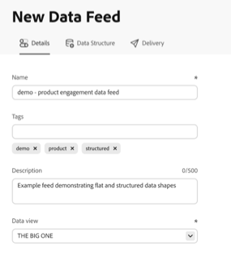

# Créer un flux de données

{{release-limited-testing}}

Lors de la création d’un flux de données, vous fournissez à Adobe les éléments suivants :

* Informations sur la destination vers laquelle envoyer les fichiers de données brutes

* Les données à inclure dans chaque fichier

* Fréquence d’envoi des données (y compris le délai de traitement pour la capture des événements d’arrivée tardive)

Avant de créer un flux de données, il est important de comprendre les bases des flux de données et de vous assurer que vous remplissez toutes les conditions préalables. Consultez la [vue d’ensemble des flux de données](data-feed-overview.md) pour en savoir plus.

## Créer et configurer un flux de données {#create-and-configure-data-feed}

<!-- markdownlint-disable MD034 -->

>[!CONTEXTUALHELP]
>id="cja_datafeed_export_file"
>title="Manifeste"
>abstract="Choisissez d’inclure un fichier manifeste avec chaque diffusion de flux de données. Les fichiers manifeste contiennent des informations pour chaque fichier inclus dans le flux de données. Lorsque vous envoyez les données d’un flux de données dans un seul package, vous pouvez également choisir d’inclure un fichier de fin, mais les fichiers manifeste sont recommandés. "

<!-- markdownlint-enable MD034 -->

<!-- markdownlint-disable MD034 -->

>[!CONTEXTUALHELP]
>id="cja_datafeed_notify"
>title="Notifier des problèmes, une fois l’opération terminée et lors de l’expiration"
>abstract="Indiquez une ou plusieurs adresses e-mail auxquelles une notification doit être envoyée lorsque le flux de données est terminé, arrive à expiration ou rencontre des problèmes. Séparez plusieurs adresses e-mail par une virgule."

<!-- markdownlint-enable MD034 -->

<!-- markdownlint-disable MD034 -->

>[!CONTEXTUALHELP]
>id="cja_datafeed_frequency_granularity"
>title="Fréquence et granularité"
>abstract="**Fréquence de diffusion** (flux actifs) : fréquence de diffusion du flux de données. Les diffusions horaires contiennent l’équivalent d’une heure de données ; les diffusions quotidiennes contiennent l’équivalent d’une journée de données.
Chaque diffusion examine également une fenêtre de traitement de 30 jours pour qualifier les segments, calculer les sessions et conserver les valeurs de dimension. La fenêtre de traitement et le délai de traitement peuvent tous deux affecter les événements inclus.

**Granularité** (flux de renvoi) : intervalle de temps utilisé pour diviser les données historiques. Chaque bloc contient l’équivalent d’une journée de données et est diffusé le plus rapidement possible, et non une fois par jour. Ce champ est toujours défini sur Quotidien et ne peut pas être modifié.
"

<!-- markdownlint-enable MD034 -->

1. Connectez-vous à [experiencecloud.adobe.com](https://experiencecloud.adobe.com) à l’aide de vos identifiants Adobe ID.

1. Sélectionnez [!UICONTROL **Customer Journey Analytics**] dans le sélecteur d’applications  en haut à droite de l’interface.

1. Dans la barre de navigation supérieure, accédez à [!UICONTROL **Composants**] > [!UICONTROL **Exports**].

1. Sélectionnez l’onglet [!UICONTROL **Flux de données**].

1. Sélectionnez [!UICONTROL **Créer**] dans le coin supérieur droit de l’écran.

   Si aucun flux de données n’a été précédemment créé, sélectionnez [!UICONTROL **Créer un flux de données**] dans le tableau vide.

   Une page s’affiche avec les onglets suivants : [!UICONTROL **Détails**], [!UICONTROL **Structure des données**] et [!UICONTROL **Diffusion**].

   

1. Dans l’onglet [!UICONTROL **Détails**], renseignez les champs suivants :

   | Champ | Fonction |
   |---------|----------|
   | [!UICONTROL **Nom**] | Nom du flux de données. Les noms doivent être uniques dans la vue de données sélectionnée et peuvent contenir jusqu’à 255 caractères. <!--[Learn more](/help/export/analytics-data-feed/df-faq.md#must-feed-names-be-unique)--> |
   | [!UICONTROL **Balises**] | Appliquez des balises au flux de données pour faciliter la catégorisation. <!--You can filter on tags as described in [Filter and search the list of data feeds](/help/export/analytics-data-feed/df-manage-feeds.md#filter-and-search-the-list-of-data-feeds) in [Manage data feeds](/help/export/analytics-data-feed/df-manage-feeds.md).--> |
   | [!UICONTROL **Description**] | Spécifiez une description pour le flux de données (500 caractères maximum). La description que vous ajoutez est visible lors de la modification du flux de données. |
   | [!UICONTROL **Vue de données**] | Sélectionnez la vue de données contenant les données à exporter.
Tenez compte des points suivants lors de la sélection d’une vue de données :
 <ul><li>Si plusieurs flux de données sont créés pour la même vue de données, chaque flux de données doit avoir des définitions de colonne différentes.</li><li>La liste des colonnes disponibles dépend de la société de connexion à laquelle appartient la vue de données sélectionnée. Si vous modifiez la vue de données, la liste des colonnes disponibles peut changer. </li></ul> |

1. Sélectionnez [!UICONTROL **Suivant**].

1. Dans l’onglet [!UICONTROL **Structure de données**], assurez-vous que la vue de données appropriée est sélectionnée dans le champ **[!UICONTROL Vue de données]**.

   <!--add screenshot-->

1. Dans le menu déroulant [!UICONTROL **Segments**], recherchez et sélectionnez n’importe quel segment pour filtrer les données incluses dans votre flux.

   Lorsque vous appliquez plusieurs segments, ils sont associés à un opérateur AND. Pour joindre des segments avec un opérateur OR, vous devez d’abord créer un segment dans le créateur de segments, puis appliquer le nouveau segment au flux de données.

   Les segments que vous appliquez ici s’ajoutent aux segments qui peuvent déjà être appliqués dans votre vue de données.

1. (Facultatif) Dans le rail de gauche, utilisez le champ **rechercher** pour localiser des composants spécifiques. Vous pouvez également sélectionner l’icône **Trier**  pour appliquer l’une des options de tri suivantes :

   | Option | Fonction |
   | --------- | ---------- |
   | [!UICONTROL **Recommandé**] | Trie les composants avec ceux qui sont recommandés en haut de la liste. Les composants utilisés le plus souvent et le plus récemment par vous ou par d’autres membres de votre organisation sont répertoriés plus haut dans la liste. |
   | [!UICONTROL **Alphabétique**] | Trie les composants par ordre alphabétique. |
   | [!UICONTROL **Catégorique**] | Trie les composants de la même manière que la mention [!UICONTROL **Recommandé**], à la différence que les composants sont regroupés séparément au lieu d’être mélangés. |

1. Ajoutez des composants à la configuration des flux de données. Le rail de gauche affiche uniquement les composants valides pour les flux de données.

   * **Glisser-déposer** : faites glisser des composants du rail de gauche vers la zone de travail. Maintenez la touche **[!UICONTROL Maj]** ou **[!UICONTROL Commande]** (macOS) ou **[!UICONTROL Ctrl]** (Windows) enfoncée pour sélectionner plusieurs composants et les faire glisser simultanément.
   * **Bouton Plus** : sélectionnez l’icône Plus  en regard de n’importe quel composant dans le rail de gauche pour l’ajouter à la zone de travail.
   * **[!UICONTROL Tout afficher]** : sélectionnez **[!UICONTROL Tout afficher]** au bas de la liste des composants pour ouvrir une boîte de dialogue affichant tous les composants disponibles. Cochez la case en regard de chaque composant à ajouter, puis sélectionnez **[!UICONTROL Ajouter la sélection]**. Lorsqu’un terme de recherche ou une balise de filtre est actif dans le rail de gauche, un bouton **[!UICONTROL Ajouter tout]** s’affiche également pour vous permettre d’ajouter tous les résultats filtrés en même temps.

   Tenez compte des points suivants lors de l’ajout de champs :

   * Certains composants sont obligatoires, ne sont pas pris en charge ou présentent des restrictions dans les flux de données. Pour plus d’informations, voir [Disponibilité des composants dans les flux de données](/help/components/exports/cja-data-feeds/df-components.md).

   * Lorsque vous ajoutez un composant qui appartient à un champ de tableau XDM (par exemple, un champ de proposition Adobe Journey Optimizer) ou un champ de mappage, une boîte de dialogue vous invite à ajouter tout autre composant du même sous-événement. Dans la sortie du flux de données, tous ces composants apparaissent dans une seule colonne. Pour plus d’informations, voir [Composants de sous-événement dans les flux de données](/help/components/exports/cja-data-feeds/df-sub-event.md)

1. (Facultatif) Réorganisez les composants sur la zone de travail en les faisant glisser. L’ordre que vous définissez est conservé dans l’ordre des colonnes du fichier de flux de données exporté.

1. (Facultatif) Redimensionnez les colonnes de la zone de travail en faisant glisser leur bordure.

   Les largeurs de colonne sont enregistrées dans un cookie et persistent la prochaine fois que vous revenez à ce flux de données sur le même navigateur.

1. (Facultatif) Modifiez l’identifiant de sortie d’un composant. L’identifiant de sortie est le nom de la colonne dans la sortie du flux de données.

   Par défaut, l’ID de sortie est l’ID du composant dans snake_case. La modification de l’identifiant de sortie affecte uniquement ce flux de données. Cela ne modifie pas l’identifiant du composant dans la vue de données. Dans la prévisualisation du schéma, la valeur `id` est l’identifiant de sortie.

   Les identifiants de sortie doivent :

   * Être unique dans le flux de données.
   * Contiennent uniquement des lettres, des chiffres et des traits de soulignement (`_`). Les espaces, points (`.`), tirets (`-`), barres obliques (`/`) et autres caractères spéciaux ne sont pas autorisés.
   * Commencez par une lettre ou un trait de soulignement.
   * Doit comporter 255 caractères ou moins.

   Les identifiants de sortie ne peuvent pas commencer par `_cja`, qui est réservé à une utilisation par Adobe.

   Vous pouvez modifier les identifiants de sortie un par un ou en bloc :

   +++ Pour modifier l’identifiant de sortie d’un seul composant

   1. Pointez sur un composant sur la zone de travail, puis sélectionnez l’icône d’information .

   1. Sélectionnez l’icône Modifier  en regard de l’identifiant, puis spécifiez un nouvel identifiant de sortie.

      <!--add screenshot-->

   +++

   +++ Pour modifier plusieurs identifiants de sortie à la fois

   1. Sous le panneau **[!UICONTROL Aperçu du schéma]**, sélectionnez **[!UICONTROL Modifier en bloc les identifiants de sortie]**.

   1. Sélectionnez **[!UICONTROL Copier]**, puis collez le fichier JSON dans un éditeur de texte ou un autre outil.

   1. Mettez à jour les valeurs `id`, qui sont les identifiants de sortie. Vous ne pouvez pas modifier les noms (`name`) ou les types (`type` et `dataType`) des composants.

   1. Collez à nouveau le fichier JSON modifié dans la boîte de dialogue, en remplaçant le fichier JSON existant, puis sélectionnez **[!UICONTROL Valider]**.

   1. Vérifiez le nombre d’identifiants modifiés, inchangés et erronés. S’il existe des erreurs, sélectionnez **[!UICONTROL Précédent]** pour les corriger.

   1. Sélectionnez **[!UICONTROL Appliquer les modifications]**.

   <!--SME CHECK: How are JSON entries matched to components (order or name)? What happens if entries are reordered, removed, or added? Where are error details shown?-->

   +++

1. (Facultatif) Utilisez les panneaux **[!UICONTROL Résumé du flux]** et **[!UICONTROL Aperçu du schéma]** sur le côté droit de la page pour passer en revue votre structure de données avant de continuer :

   * Le **[!UICONTROL résumé des flux]** affiche un nombre réel de composants, colonnes, dimensions et mesures que vous avez ajoutés.
   * L’**[!UICONTROL aperçu du schéma]** affiche une représentation JSON du schéma de flux de données qui se met à jour au fur et à mesure que vous ajoutez ou réorganisez des composants.
   * Le bouton **[!UICONTROL Exemples de lignes]** ouvre une boîte de dialogue qui affiche des exemples de lignes de sortie afin que vous puissiez vérifier que la structure semble correcte. Cette boîte de dialogue affiche uniquement des exemples de données et ne reflète pas vos données réelles.

   <!--add screenshot-->

1. Sous l’onglet [!UICONTROL **Diffusion**], dans la section [!UICONTROL **Planning**], choisissez le type de flux que vous souhaitez créer (actif ou de renvoi), puis spécifiez la fréquence, le délai de traitement et d’autres options de configuration :

   <!--add screenshot-->

   | Champ | Fonction |
   |---------|----------|
   | [!UICONTROL **Type de flux**] | Sélectionnez le type de flux que vous souhaitez créer :<ul><li>[!UICONTROL **Flux en direct**] : exporte les données actuelles et futures.</li><li>[!UICONTROL **Flux de renvoi**] : exporte les données historiques. </li></ul> |
   | [!UICONTROL **Date de début**] | Date de début du flux de données. Pour les flux en direct, il doit s’agir d’aujourd’hui ou d’une date ultérieure. Pour les flux de renvoi, il doit s’agir d’une date passée dans la fenêtre de conservation des données de la vue de données. La date de début est basée sur le fuseau horaire de la vue de données. |
   | [!UICONTROL **Date d’expiration**]  Disponible uniquement pour les flux en direct | Date à laquelle le flux de données expire et ne s’exécute plus. La date est basée sur le fuseau horaire de la vue de données. |
   | [!UICONTROL **Date de fin**]  Disponible uniquement pour les flux de renvoi | Date de fin du flux de données. La date de fin ne peut pas être dans le futur. La date est basée sur le fuseau horaire de la vue de données. |
   | [!UICONTROL **Fréquence**]  Disponible uniquement pour les flux en direct | Sélectionnez la fréquence d’envoi du flux de données. Les événements dont la date et l’heure se trouvent dans la fenêtre de fréquence sont inclus dans la diffusion du flux de données. 
Sélectionnez cette option pour inclure l’équivalent d’une heure de données ou d’un jour de données.
<ul><li>**Quotidien** : les flux contiennent l’équivalent d’une journée complète de données, de minuit à minuit dans le fuseau horaire de la vue de données.</li><li>**Par heure** : les flux contiennent l’équivalent d’une heure de données.</li></ul> 
Chaque diffusion utilise également une fenêtre de traitement progressive de 30 jours, précédant la fenêtre de fréquence incluse, pour qualifier les segments, calculer les sessions et conserver les valeurs de dimension. La fenêtre de traitement et le paramètre [!UICONTROL **Délai de traitement**] peuvent tous deux affecter les événements inclus. Pour plus d’informations, voir [Présentation de la fenêtre de traitement](#data-feed-processing-window) et [Présentation du délai de traitement](#data-feed-processing-delay).
 |
   | [!UICONTROL **Granularité**]  Disponible uniquement pour les flux de renvoi | Intervalle de temps utilisé pour diviser les données historiques en blocs. Chaque bloc contient l’équivalent d’une journée complète de données, de minuit à minuit dans le fuseau horaire de la vue de données. 
La granularité détermine la manière dont les données sont regroupées, et non la fréquence de diffusion. Les données de renvoi sont diffusées le plus rapidement possible, et non une fois par jour.

Ce champ est toujours défini sur [!UICONTROL **Quotidien**] et ne peut pas être modifié.
 |
   | [!UICONTROL **Délai de traitement**] | Temps d’attente de Customer Journey Analytics avant de traiter un fichier de flux de données. Tous les événements tardifs qui arrivent pendant le délai de traitement sont inclus dans le flux de données. 
Choisissez un délai suffisant pour que les données les plus lentes de votre connexion terminent le traitement. Si le délai est trop court, les données en cours de traitement ne sont pas incluses dans le fichier de flux de données.

Le délai de traitement minimal est de 2 heures. La valeur par défaut est basée sur les jeux de données de votre connexion. Par exemple, si le groupement est activé, la valeur par défaut est de 6 heures. Certains types de données nécessitent un délai plus long. Le délai que vous choisissez dépend des types de données de votre connexion, telles que les données de diffusion en continu, par lots, groupées, de recherche ou de profil.

Avant de configurer cette option, consultez les détails et les exemples décrits dans la section ci-dessous, [Comprendre le délai de traitement](#data-feed-processing-delay).
 |
   | [!UICONTROL **Format de compression**] | Sélectionnez le format de compression des fichiers de sortie Parquet diffusés vers votre destination cloud. Choisissez l’un des formats suivants :<ul><li>[!UICONTROL **Snappy**] : compression et décompression rapides avec des tailles de fichier modérées. Largement pris en charge par les plateformes de données modernes telles que BigQuery, Snowflake et Apache Spark.</li><li>[!UICONTROL **GZip**] : largement compatible, y compris avec les outils qui ne prennent pas en charge Snappy en mode natif. Recommandé si votre pipeline en aval nécessite une norme de compression largement reconnue.</li><li>[!UICONTROL **Z Standard (Zstd)**] : Efficacité de compression élevée avec décompression rapide. Convient si la réduction de la taille du fichier est une priorité et que vos outils prennent en charge Zstd.</li></ul>
Tous les formats compressent les données à l’intérieur de chaque fichier Parquet, une colonne à la fois, de sorte que votre entrepôt de données peut toujours lire uniquement les colonnes dont une requête a besoin.

Pour plus d’informations sur les avantages de Parquet et sur la manière d’interroger ou de charger les fichiers après leur diffusion, voir [ Utilisation de fichiers Parquet dans les flux de données ](/help/components/exports/cja-data-feeds/df-parquet.md).
 |

1. Sous l’onglet [!UICONTROL **Diffusion**], dans la section [!UICONTROL **Destination**], configurez la destination vers laquelle vous souhaitez envoyer les données.

   >[!NOTE]
   >
   >Tenez compte de ce qui suit lors de la configuration du rapport de destination :
   >
   ><!--* Adobe recommends using a cloud account for your report destination. [Legacy FTP and SFTP accounts](/help/components/locations/configure-import-accounts.md) are available, but are not recommended.-->
   >* Tous les comptes cloud que vous avez précédemment configurés peuvent être utilisés pour les flux de données. Vous pouvez configurer des comptes cloud à partir du gestionnaire d’emplacements dans [Composants > Exportations > Comptes d’emplacement](/help/components/exports/cloud-export-accounts.md).
   >
   >* Les comptes cloud sont associés à votre compte utilisateur Customer Journey Analytics. Les autres utilisateurs ne peuvent pas utiliser ni afficher les comptes cloud que vous configurez, sauf si vous les rendez disponibles pour tous les utilisateurs de votre organisation.
   >
   >* Vous pouvez modifier les emplacements que vous créez à partir du gestionnaire d’emplacements dans [Composants > Exportations > Emplacements](/help/components/exports/cloud-export-locations.md).

   Renseignez les champs suivants :

   | Champ | Fonction |
   |---------|----------|
   | [!UICONTROL **Afficher les destinations pour tous les utilisateurs**] | Si vous êtes un administrateur ou une administratrice système, vous pouvez activer cette option pour afficher les destinations créées par tous les utilisateurs et utilisatrices de votre organisation. Lorsque cette option est désactivée, seules les destinations que vous avez créées s’affichent. |
   | [!UICONTROL **Compte**] | Effectuez l’une des opérations suivantes :<ul><li>**Utiliser un compte existant :** sélectionnez le menu déroulant en regard du champ **[!UICONTROL Compte]**. Vous pouvez également commencer à saisir le nom du compte, puis le sélectionner dans le menu déroulant. 
Vous ne pouvez accéder aux comptes que si vous les avez configurés ou s’ils sont partagés avec une organisation dont vous faites partie.
</li><li>**Créer un compte :** sélectionnez **[!UICONTROL Ajouter un compte]** dans le menu **[!UICONTROL Compte]**. Pour plus d’informations sur la configuration du compte, voir [Configuration des comptes d’exportation dans le cloud](/help/components/exports/cloud-export-accounts.md).</li></ul> |
   | [!UICONTROL **Emplacement**] | Effectuez l’une des opérations suivantes :<ul><li>**Utiliser un emplacement existant :** sélectionnez le menu déroulant en regard du champ **[!UICONTROL Emplacement]**. Vous pouvez également commencer à saisir le nom de l’emplacement, puis le sélectionner dans le menu déroulant.</li><li>**Créer un emplacement :** sélectionnez **[!UICONTROL Ajouter un emplacement]** dans le menu **[!UICONTROL Emplacement]**. Pour plus d’informations sur la configuration de l’emplacement, voir [Configuration des emplacements d’exportation dans le cloud](/help/components/exports/cloud-export-locations.md).</li></ul> |
   | [!UICONTROL **Remplacer le chemin d’accès ou le nom de fichier par défaut**] | Activez cette option pour remplacer le chemin d’accès ou le nom de fichier par défaut défini pour l’emplacement sélectionné. Le remplacement s’applique uniquement à ce flux de données et détermine où les fichiers de flux de données sont envoyés.
Lorsque cette option est activée, le champ [!UICONTROL **Chemin d’accès ou nom de fichier**] s’affiche.
 |
   | [!UICONTROL **Chemin ou nom de fichier**]  Disponible uniquement lorsque [!UICONTROL **Remplacer le chemin ou le nom de fichier par défaut**] est activé | Indiquez un chemin d’accès ou un nom de fichier (ou les deux) pour déterminer où les fichiers sont envoyés à l’emplacement sélectionné. Pour enregistrer des fichiers dans le dossier de niveau supérieur de l’emplacement, spécifiez `/`.
Pour les flux en direct, vous pouvez utiliser l’une des variables suivantes pour rendre le chemin d’accès ou le nom de fichier dynamique :
<ul><li>**{yyyy}** : année civile à 4 chiffres (sensible à la casse)</li><li>**{yy}** : année civile à 2 chiffres (sensible à la casse)</li><li>**{MM}** : mois à 2 chiffres (sensible à la casse)</li><li>**{dd}** : jour à 2 chiffres (sensible à la casse)</li><li>**{HH}** : heure à 2 chiffres (sensible à la casse)</li><li>**{mm}** : minutes à 2 chiffres (sensible à la casse)</li><li>**{ss}** : secondes à 2 chiffres (sensible à la casse)</li><li>**{fff}** : nanosecondes à 3 chiffres (sensible à la casse)</li><li>**{instance_id}** : UUID de requête (instance)</li><li>**{export_id}** : UUID de l&#39;export (planning)</li><li>**{idx}** : index démarré à partir de 0 (incrémenté pour chaque fichier)</li><li>**{total}** : nombre total de fichiers pour l&#39;ensemble de la tâche de transfert</li><li>**{completion_millis}** : heure de transfert en millisecondes</li></ul>
Par exemple, si vous spécifiez `${yyyy}/${MM}/${dd}/my-feed-${instance_id}-${idx}`, un flux dynamique diffusé le 15 janvier 2027 aura le chemin et le nom de fichier suivants : `[prefix_folder_name]/2027/01/15/my-feed-[UUID]-1.parquet`
 |
   | [!UICONTROL **Notifier des problèmes, une fois l’opération terminée et lors de l’expiration**] | Indiquez une ou plusieurs adresses e-mail auxquelles une notification doit être envoyée lorsque le flux de données est terminé, arrive à expiration ou rencontre des problèmes. Séparez plusieurs adresses e-mail par une virgule. |
   | [!UICONTROL **Activer le manifeste**] | Choisissez d’inclure un fichier manifeste avec chaque diffusion de flux de données. Le fichier manifeste contient des informations pour chaque fichier inclus dans le flux de données. |

1. Sélectionnez **[!UICONTROL Enregistrer]**.

## Présentation de la fenêtre de traitement {#data-feed-processing-window}

La **fenêtre de traitement** est une période variable de 30 jours qui précède et inclut la fenêtre de fréquence (heure ou jour) sélectionnée. Customer Journey Analytics utilise les données de la fenêtre de traitement pour traiter chaque diffusion de flux de données. La fenêtre de traitement est toujours de 30 jours et ne peut pas être modifiée.

La fenêtre de fréquence détermine les événements inclus dans la diffusion. La fenêtre de traitement fournit le contexte historique nécessaire pour classer correctement ces événements, par exemple les segments pour lesquels ils sont qualifiés, la session à laquelle ils appartiennent et les valeurs de dimension qui leur persistent.

La fenêtre de traitement, ainsi que la fenêtre de fréquence, fonctionnent de la même manière que la fenêtre de création de rapports d’Analysis Workspace. Cependant, il existe [des différences majeures](/help/components/exports/cja-data-feeds/df-comparison-workspace.md#processing-window). Ces différences peuvent entraîner des incohérences de données entre les rapports Workspace et les diffusions de flux de données.

La qualification des segments, le calcul des sessions, la persistance des dimensions et les transformations de champs dérivés sont chacun pris en compte lors du traitement des données dans la fenêtre de traitement :

### Qualification de segment

Lorsqu’un segment est appliqué à votre définition de flux de données, les données de la fenêtre de traitement déterminent les événements, sessions ou personnes qui remplissent les critères pour le segment. Le paramètre de conteneur du segment détermine la portée. (Les conteneurs possibles sont : Personne, Session ou Événement. Le B2B inclut les conteneurs supplémentaires suivants : compte global, compte, opportunité, groupe d’achat.)

>[!BEGINSHADEBOX]

**Exemple :**

Supposons que vous souhaitiez créer un flux de données pour comprendre le comportement des utilisateurs qui font partie d’une campagne marketing spécifique, la campagne B.

Pour ce faire, appliquez un segment au flux de données appelé _Utilisateurs dans la campagne B_, en indiquant que seuls les événements liés aux utilisateurs de ce segment doivent être inclus dans le flux de données.

Dans ce cas, les utilisateurs ne sont inclus dans le flux de données que s’ils remplissent **les deux** les conditions suivantes :

* L’utilisateur a eu un événement dont la date et l’heure se trouvent dans la fenêtre de fréquence du flux de données (l’heure ou le jour donné du flux de données).
* L’utilisateur s’est qualifié pour le segment _Campaign B_ **parfois dans la fenêtre de traitement**.

  Par exemple, un utilisateur qualifié pour le segment 9 jours auparavant **est inclus** dans le flux de données. Un utilisateur qualifié pour la dernière fois il y a 45 jours **n’est pas inclus**, car cet événement se situe en dehors de l’intervalle de traitement de 30 jours.

>[!ENDSHADEBOX]

### Calcul de session

Les limites de session sont calculées en utilisant tous les événements de la fenêtre de traitement, et pas seulement ceux de la fenêtre de fréquence. Une session qui a démarré avant la fenêtre de fréquence est toujours reconnue comme la même session.

L’ID de session est basé sur la personne, l’heure de début de la session et les paramètres de session dans votre vue de données. Une session conserve le même ID de session sur toutes les diffusions. Vous pouvez donc joindre des événements à partir d’une session qui s’étend sur plusieurs diffusions horaires ou quotidiennes.

Tenez compte des points suivants lorsque vous utilisez des sessions dans les flux de données :

* Si une session a démarré avant la fenêtre de traitement, les événements précédents ne sont pas disponibles. Les valeurs de session peuvent donc différer d’Analysis Workspace. Pour plus d’informations, voir [Comprendre les écarts de données entre les flux de données et Analysis Workspace](/help/components/exports/cja-data-feeds/df-comparison-workspace.md).
* La modification des paramètres de session dans votre vue de données modifie les ID de session. Les ID de session dans les diffusions ultérieures ne correspondent pas aux ID de session dans les diffusions antérieures.

### Persistance de Dimension

Lorsque vous définissez la persistance sur une dimension, vous définissez également une expiration qui détermine la durée pendant laquelle l’élément de dimension persiste au-delà de l’événement sur lequel il est défini.

La fenêtre de traitement limite la persistance pour chaque paramètre d’expiration. Les valeurs définies avant la fenêtre de traitement ne sont pas prises en compte, sauf avec l’expiration [!UICONTROL **Heure personnalisée**] :

* [!UICONTROL **Session**] : les valeurs persistent jusqu’à la fin de la session. Si une session a démarré avant la fenêtre de traitement, les valeurs définies avant la fenêtre de traitement ne sont pas prises en compte.
* [!UICONTROL **Créneau de rapport des personnes**] : le créneau de traitement de 30 jours est utilisé comme délai d’expiration. Seules les valeurs définies dans la fenêtre de traitement persistent.
* [!UICONTROL **Heure personnalisée**] : les valeurs persistent pour l’heure personnalisée définie sur la dimension. Si la durée personnalisée est supérieure à la fenêtre de traitement de 30 jours, le flux de données revient avant le début de la fenêtre de traitement (jusqu’à 90 jours) afin que les valeurs de dimension définies avant la fenêtre de traitement puissent persister pour les événements dans la diffusion.

  <!--FOLLOW-UP: Remove this note when the persistence back-end change (AN-495620) ships. Also remove the matching sentence in df-comparison-workspace.md (Dimension persistence bullet).-->

  >[!NOTE]
  >
  >Actuellement, les expirations du temps personnalisé sont limitées à la fenêtre de traitement de 30 jours. Si la durée personnalisée est supérieure à 30 jours, la fenêtre de traitement est utilisée comme expiration à la place et les valeurs définies avant la fenêtre de traitement ne sont pas prises en compte. La prise en charge des délais personnalisés qui s’étendent au-delà de la fenêtre de traitement sera bientôt disponible.

* [!UICONTROL **Mesure**] : les valeurs persistent jusqu’à ce que la mesure sélectionnée soit effectuée. Les valeurs définies avant la fenêtre de traitement ne sont pas prises en compte.

Pour plus d’informations sur la définition de la persistance sur les dimensions dans la vue de données, voir [Paramètres des composants de persistance](/help/data-views/component-settings/persistence.md). Pour plus d’informations sur les différences de persistance dans les flux de données par rapport à Analysis Workspace, voir [Comprendre les écarts de données entre les flux de données et Analysis Workspace](/help/components/exports/cja-data-feeds/df-comparison-workspace.md#processing-window).

>[!BEGINSHADEBOX]

**Exemple :**

Supposons que dans votre flux de données vous souhaitiez savoir quelle campagne marketing les utilisateurs ont vue à l’origine avant d’accéder à votre site.

Pour ce faire, définissez la persistance sur la dimension Campagnes avec Original comme modèle d’affectation et [!UICONTROL **Fenêtre de création de rapports de personne**] comme expiration.

Dans ce cas, la campagne d’origine s’affiche dans la sortie du flux de données uniquement si les utilisateurs et utilisatrices remplissent **les deux** les conditions suivantes :

* L’utilisateur a eu un événement dont la date et l’heure se trouvent dans la fenêtre de fréquence du flux de données (l’heure ou le jour donné du flux de données).

* L’utilisateur s’est qualifié pour la campagne d’origine **parfois dans la fenêtre de traitement**.

  Si l’utilisateur s’est qualifié pour la campagne d’origine il y a 9 jours, la campagne d’origine **est incluse** dans le flux de données. Si l’utilisateur s’est qualifié il y a 45 jours, la campagne d’origine **n’est pas incluse**, car elle se situe en dehors de l’intervalle de traitement de 30 jours.

>[!ENDSHADEBOX]

### Transformations de champ dérivées

Toutes les fonctions de champ dérivé qui font référence à des conteneurs utilisent la fenêtre de traitement dans les exportations de flux de données. Quelles sont les fonctionnalités de date disponibles dans les champs dérivés ? <!--Not sure how this applies.-->

## Comprendre le délai de traitement {#data-feed-processing-delay}

<!-- markdownlint-disable MD034 -->

>[!CONTEXTUALHELP]
>id="cja_datafeed_processing_delay"
>title="Délai de traitement"
>abstract="Temps d’attente du système avant de traiter un fichier de flux de données. Tous les événements tardifs qui arrivent pendant le délai sont inclus dans le flux.
Le délai de traitement minimal est de 2 heures, mais certains types de données nécessitent plus de temps. Choisissez un délai suffisamment long pour les données les plus lentes de votre connexion. Si le délai de traitement est trop court, certaines données peuvent ne pas être incluses dans le flux.
"

<!-- markdownlint-enable MD034 -->

### Fonctionnement du délai de traitement

Le délai de traitement correspond au temps d’attente de Customer Journey Analytics avant de traiter un fichier de flux de données. Tous les événements tardifs qui arrivent pendant le délai de traitement sont inclus dans le flux de données.

Les délais de traitement sont nécessaires pour différentes raisons, notamment pour tenir compte de la latence du pipeline, pour permettre aux implémentations mobiles de mettre en ligne les appareils hors ligne et d’envoyer des données, ou pour adapter les processus côté serveur de votre entreprise à la gestion des fichiers précédemment traités.

Le délai de traitement minimal est de 2 heures, mais certains types de données nécessitent un délai plus long.

>[!BEGINSHADEBOX]

**Exemple :**

Supposons qu’un flux de données horaire contienne des données de 13 h à 14 h et que le délai de traitement soit de 2 heures. Le traitement de ce fichier de flux de données commence à 16h00 et inclut toutes les données arrivées avant le début du traitement.

>[!ENDSHADEBOX]

### Choisissez un délai de traitement en fonction de vos données

La disponibilité de différents types de données varie en fonction du temps nécessaire pour les obtenir dans Customer Journey Analytics. Les données passent par deux phases de traitement, et le temps de chaque phase s’ajoute au total.

Choisissez un délai de traitement suffisamment long pour que les données les plus lentes de votre connexion puissent terminer les deux phases. Si le délai est trop court, les données en cours de traitement ne sont pas incluses dans le fichier de flux de données.

Lorsque vous créez un flux de données, le délai de traitement correspond par défaut à une valeur recommandée en fonction des jeux de données de votre connexion. Par exemple, si le groupement est activé pour la connexion, la valeur par défaut est de 6 heures. Vous pouvez choisir un délai plus court, jusqu’à un minimum de 2 heures, mais un avertissement s’affiche, car certaines données peuvent ne pas être incluses dans le flux de données.

#### Phase 1 : les données arrivent dans le lac de données Experience Platform

Les heures d’arrivée varient en fonction du type de données que vous collectez. Choisissez un délai qui s’adapte au type de données que vous collectez.

* **Jeux de données d’événements de l’ingestion Edge Network ou en flux continu** : les données arrivent généralement dans le lac de données dans les 60 minutes (voir [Latences](/help/technotes/guardrails.md#latencies)).

* **Jeux de données du connecteur source Analytics** : les données arrivent généralement dans le lac de données dans les 2,25 heures (voir [Latences](/help/technotes/guardrails.md#latencies)).

  <!--Default delay for Analytics source connector datasets is TBD (Oct 19 decision); add when confirmed.-->

* **Jeux de données provenant d’autres connecteurs source** : la latence varie en fonction du connecteur source et du moment d’envoi des lots. Le traitement en amont dans Experience Platform, tel que la préparation des données, peut ajouter du temps.

* **Jeux de données de recherche** : le temps nécessaire pour que les données arrivent dans le lac de données dépend de la fréquence de chargement des données. Les données de recherche sont généralement chargées sous la forme d’une copie complète d’une base de données, dans laquelle seul un petit pourcentage d’enregistrements a été modifié. Chargez les données de recherche par plus petits lots pour réduire le temps de traitement.

  Les petits chargements sont généralement traités dans les délais les plus courts.

  Les chargements volumineux (par exemple, un chargement hebdomadaire de millions d’enregistrements) sont traités avec une priorité inférieure et peuvent prendre 3 à 4 heures de plus. Dans le cas de chargements volumineux, les données d’événement ne sont pas retardées, mais les valeurs de recherche peuvent ne pas refléter les mises à jour les plus récentes.

* **Jeux de données de profil** : le temps nécessaire pour que les données arrivent dans le lac de données dépend de la fréquence de chargement des données. Les données de profil sont généralement ingérées par lots volumineux, tels qu’un instantané quotidien de la table des profils complète. Chargez les données de profil par lots plus petits afin de réduire le temps de traitement.

  Les petits chargements sont généralement traités dans les délais les plus courts.

  Les chargements volumineux (par exemple, un chargement hebdomadaire de millions d’enregistrements) sont traités avec une priorité inférieure et peuvent prendre 3 à 4 heures de plus. Dans le cas de chargements volumineux, les données d’événement ne sont pas retardées, mais les valeurs de profil peuvent ne pas refléter les mises à jour les plus récentes.

#### Phase 2 : les données sont ingérées à partir du lac de données dans Customer Journey Analytics

Les délais d’ingestion des données varient selon que le groupement est activé ou non dans le jeu de données.

* **Jeux de données non groupés** : cette opération peut prendre jusqu’à 90 minutes (voir [Latences](/help/technotes/guardrails.md#latencies)).

* **Jeux de données groupés** : le groupement peut ajouter jusqu’à 4 heures en plus des 90 minutes nécessaires pour les jeux de données non groupés (voir [Latences](/help/technotes/guardrails.md#latencies)). Si le groupement est activé pour la connexion, le délai par défaut est de 6 heures. Les données mises à jour par une relecture d’assemblage ne sont généralement pas incluses dans les fichiers de flux de données déjà traités.

>[!BEGINSHADEBOX]

**Exemple :**

Si votre connexion comprend plusieurs types de données, choisissez un délai qui prend en compte les données les plus lentes. Dans l&#39;exemple ci-dessous, cela fait environ 8 heures.

L’assemblage peut ajouter jusqu’à 4 heures à l’ingestion dans Customer Journey Analytics. Pour en tenir compte, ajoutez 4 heures au délai pour toutes les données regroupées.

| Source de données | Phase 1 : Arrivée dans le lac de données | Phase 2 : ingestion dans Customer Journey Analytics | Total |
| --- | --- | --- | --- |
| Ingestion par Edge Network ou par flux | 60 minutes | 90 minutes 
Sans couture
 | 2,5 heures |
| Connecteur source Analytics | 2,25 heures | 90 minutes + 4 heures pour la couture 
Avec couture
 | 7,75 heures |

>[!ENDSHADEBOX]

